# MIMI & CO. — Gelato & Candy Lab

A single-page gelato shop site built as a portfolio piece: **Astro 7 + Tailwind CSS 4 + Three.js**, with a neo-pop look where the 3D matches the UI (thick ink outlines, hard shadows, pastel palette) and a scroll-driven 3D story that assembles a scoop of gelato from raw ingredients.

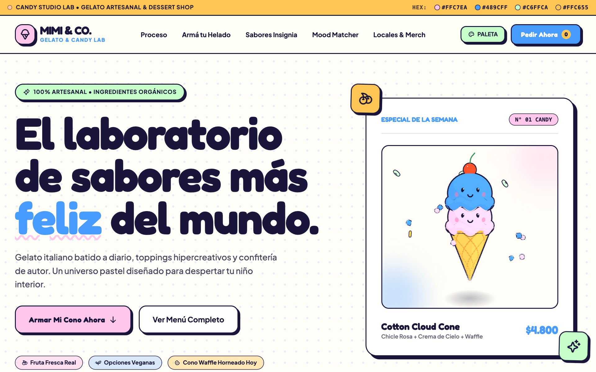

## Quick path

```bash
pnpm install
pnpm dev        # http://localhost:4321
```

| Script | What it does |
| --- | --- |
| `pnpm dev` | Dev server with HMR |
| `pnpm build` | Static production build into `dist/` |
| `pnpm preview` | Serves the production build |
| `pnpm check` | Type-checks `.astro` and `.ts` files (`astro check`) |

Requires Node 22.23.4+ (an Astro 7 requirement) and pnpm. The 3D parts need WebGL 2; without it every scene falls back to a 2D version (see [Fallbacks](#progressive-enhancement)).

## What's in it

| Section | What to look at |
| --- | --- |
| **Hero** | A 3D "Cotton Cloud Cone" assembles itself on load: scoop, scoop, cherry. Drag to spin it. |
| **Scroll story** | The section pins for ~4 screens and the scene is a pure function of scroll progress, so it also plays in reverse. |
| **Cone builder** | Stack up to 3 scoops and toppings in 3D with spring physics. "Order" sends the cone flying and a fresh one pops in. |
| **Catalog + mood matcher** | Filterable cards with staggered re-entry; mood result crossfades with a blur bridge. |
| **Palette drawer** | Click any swatch to copy its HEX. Scales in from its corner, stays `inert` when closed. |

### Scroll story — from ingredients to a scoop

The scene is scrubbed by scroll, not triggered by events: ingredients dive into the tub, a whisk swirls the batter from cream to pink, the tub frosts over, and a scoop drops a smiling ball onto a cone.

| | |
| --- | --- |
| 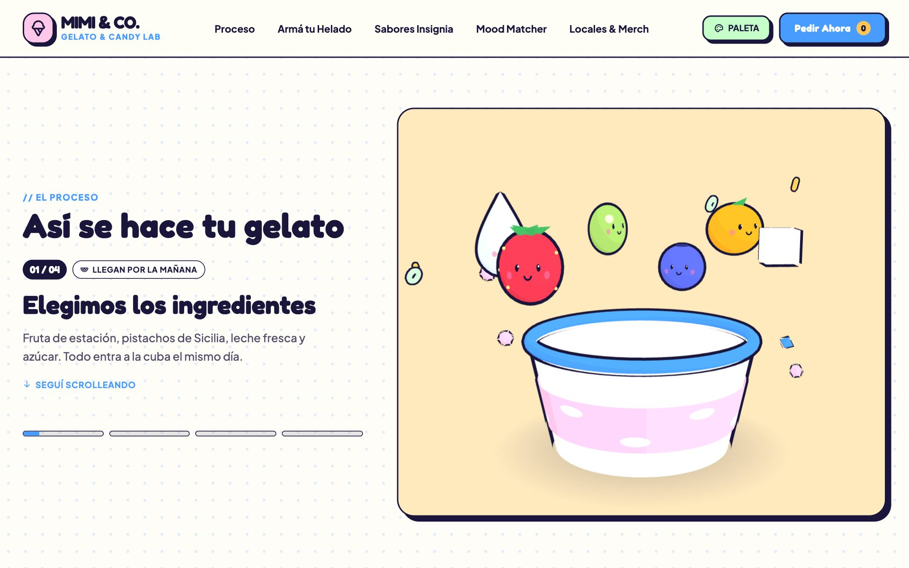 | 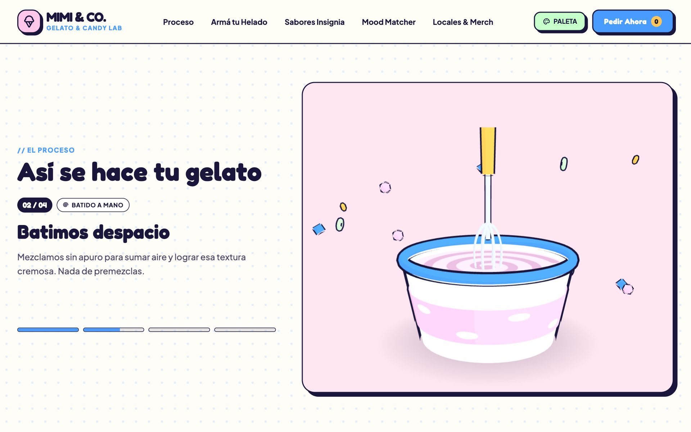 |
| 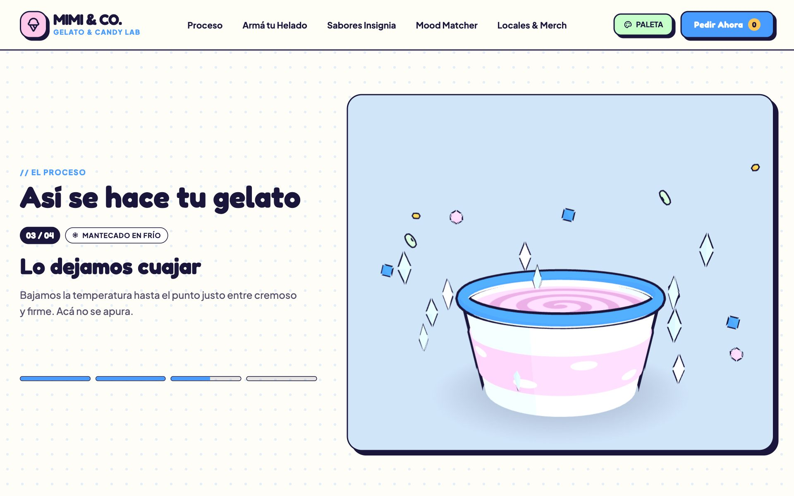 | 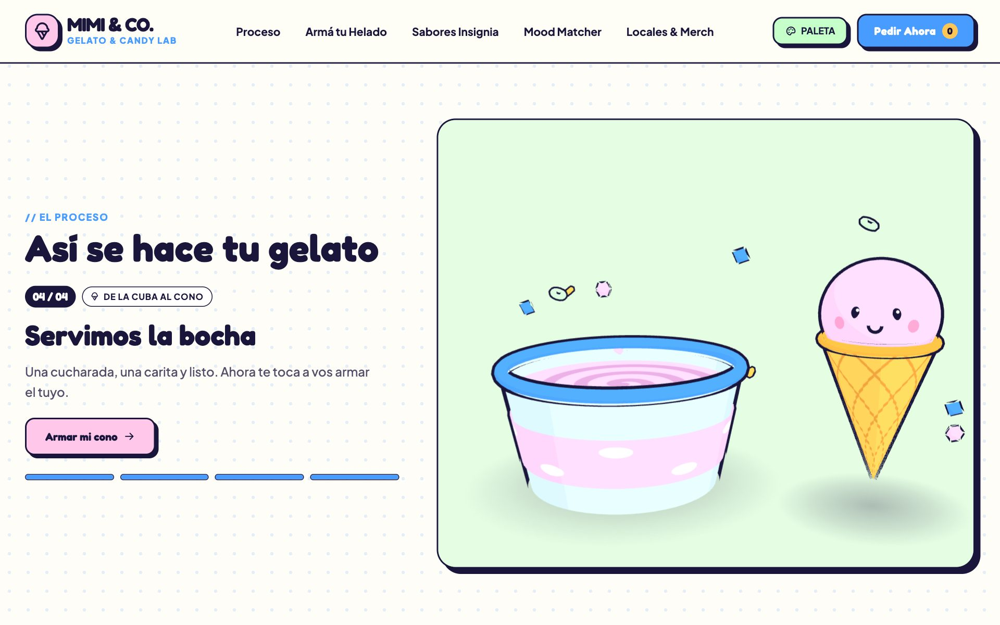 |

### Cone builder

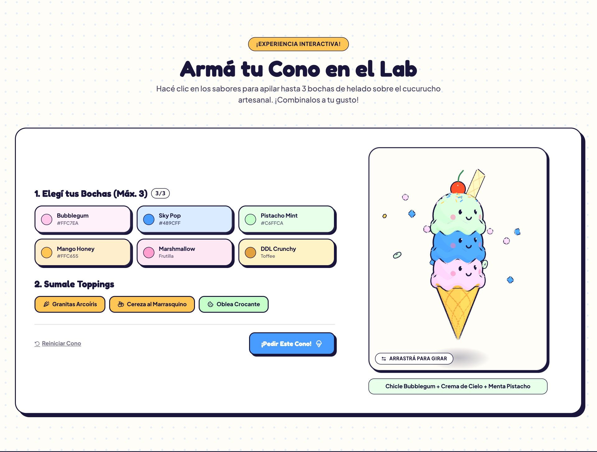

### Catalog and mood matcher

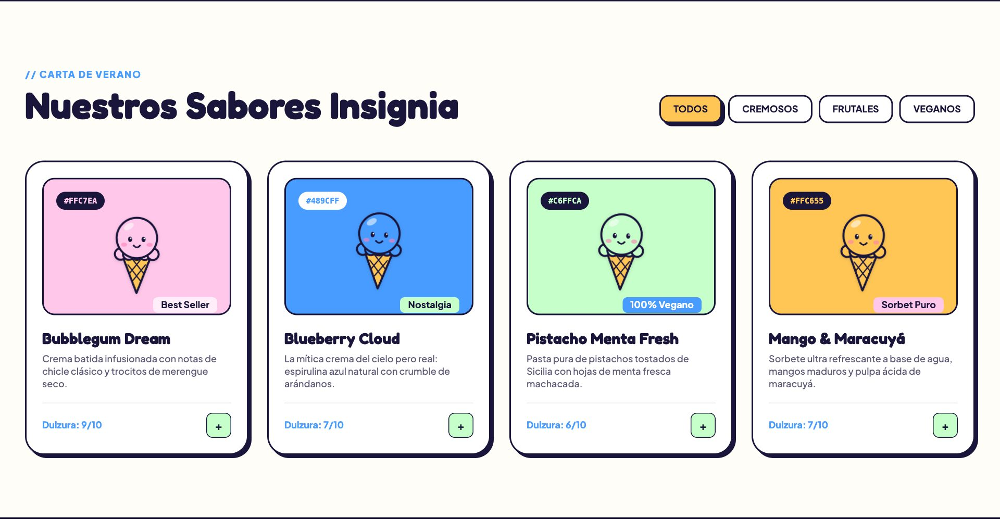
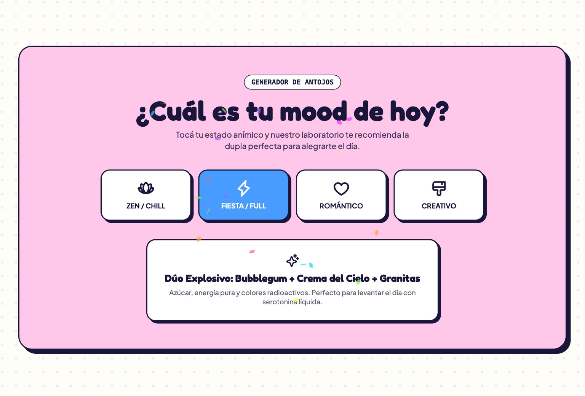

### Mobile

<p>
  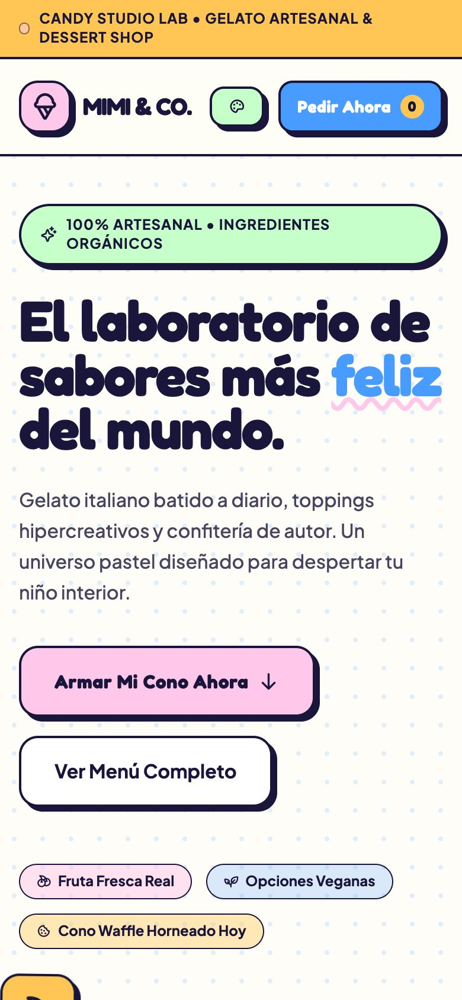
  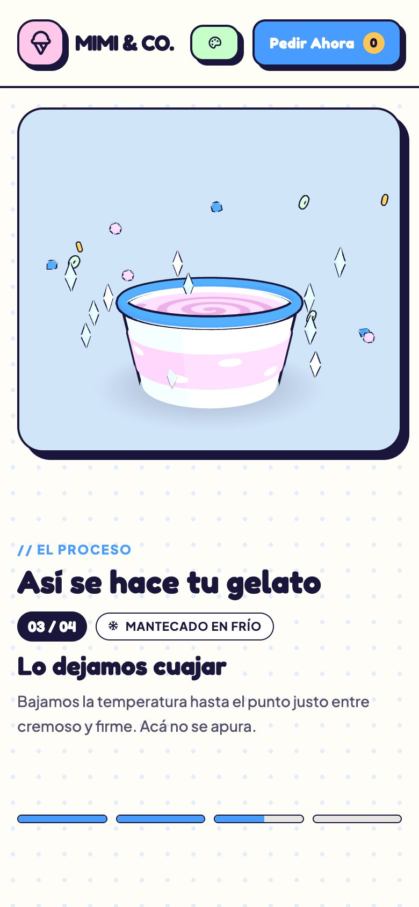
  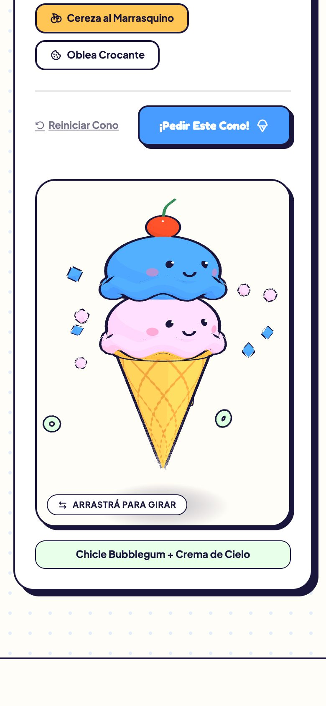
</p>

## How it's built

| Topic | Decision |
| --- | --- |
| **Stack** | Astro 7 (static, zero framework runtime), Tailwind CSS 4 via `@tailwindcss/vite`, Three.js r186, TypeScript, Phosphor icons, `canvas-confetti`. |
| **Design tokens** | One `@theme` block in `src/styles/global.css`: `candy-*` colors, fonts (Fredoka + Plus Jakarta Sans), hard `pop-*` shadows, keyframes, and a strong ease-out as the default transition curve. |
| **3D look** | `MeshToonMaterial` with a 3-step gradient + an inverted-hull outline (`ShaderMaterial` that pushes back faces out along their normals). All models are procedural, with no external assets. |
| **Shared kit** | `toon-kit.ts` holds the material, outline, face, scoop and cone builders. Each scene creates its own kit so GPU resources are never shared across WebGL contexts. |
| **Physics** | Scoops drop with damped springs and a volume-preserving squash & stretch. Sprinkles are a 70-instance `InstancedMesh`. |
| **Scroll story** | `process-scene.ts` is a pure function of `(progress, time)`. Keyframes + a timeline constant `T` drive it; progress is damped so scrubbing feels smooth in both directions. |
| **Performance** | Scenes are dynamic `import()`s (the hero on load, the story and builder near the viewport); each render loop pauses when offscreen; pixel ratio capped at 2. |
| **Motion system** | `pressable` utility (named properties only, instant `:active` feedback), declarative scroll reveals (`data-reveal`) built on WAAPI, and `transform`/`opacity`/`clip-path` only. Motion follows Emil Kowalski's design-engineering principles. |

### Bundle (gzip)

| Chunk | Size | When it loads |
| --- | --- | --- |
| `toon-kit` (Three.js + shared models) | ~135 KB | At page load (the hero uses it) |
| Cone scene / process scene | 3 KB / 4 KB | Hero immediately, story and builder near the viewport |
| App script | 8 KB | At page load |
| CSS | 20 KB | At page load |

### Progressive enhancement

| Case | Behavior |
| --- | --- |
| **No WebGL** | The hero, story and builder keep their 2D illustrations, and the 2D builder still works. Verified with WebGL disabled. |
| **`prefers-reduced-motion`** | Nothing is hidden or split, ambient loops stop, smooth scroll is off. Fades remain. |
| **No JS** | Scroll reveals only hide content when the `.js` class is set, so nothing stays invisible. |
| **Accessibility** | Split headings keep an `aria-label`, inactive story steps are `aria-hidden`, the toast is `role="status"`, and the closed palette drawer is `inert`. |

## Project structure

```
src/
├── components/   One .astro file per section (Hero, Story, ConeBuilder, FlavorCatalog…)
├── data/         Flavors, toppings, moods, palette, story steps
├── layouts/      Document shell + fonts
├── pages/        index.astro
├── scripts/
│   ├── toon-kit.ts        Shared toon material, outline, models
│   ├── cone-scene.ts      Interactive cone (hero + builder)
│   ├── process-scene.ts   Scroll-scrubbed tub scene
│   ├── story.ts           Scroll progress → scene + UI
│   ├── reveal.ts          Declarative scroll reveals
│   └── …                  Cart, catalog, palette, toast, motion helpers
└── styles/       Tailwind theme + utilities
docs/screenshots/ README images
```

## Known limitations

- Verified in headless Chromium with software WebGL, so frame rate on a real GPU and on real phones hasn't been profiled.
- There are no automated tests; verification is scripted browser checks run by hand.
- Copy, prices and locations are placeholder content.
